# Zoe Cruz

Proyectos de desarrollo web, visión por computadora y aprendizaje automático.

## Repositorios y enlaces

<!-- PROJECTS:START -->
- [archivault-portafolio](https://github.com/ZoeCrz/archivault-portafolio) · Catálogo de colecciones, comunidad y marketplace con React y Django.
- [primolandia](https://github.com/ZoeCrz/primolandia) · División exacta de enteros representados mediante factores primos en Java.
- [rostros-arff](https://github.com/ZoeCrz/rostros-arff) · Extracción de rostros con OpenCV y exportación de conjuntos de datos ARFF.
- [som-3d](https://github.com/ZoeCrz/som-3d) · Mapa 3D de Kohonen interactivo para explorar semejanzas entre animales.
- [techhand](https://github.com/ZoeCrz/techhand) · Prototipo de mano robótica con detección de gestos y control serial para ESP32.
- [techparts](https://github.com/ZoeCrz/techparts) · Tienda y panel administrativo de demostración con ASP.NET Web Forms, C# y MySQL.
<!-- PROJECTS:END -->

[Perfil de GitHub](https://github.com/ZoeCrz)

Panel inspirado en los diseños de <a href="https://www.gitskins.com/readme-generator">GitSkins</a>. La actualización consulta datos públicos de GitHub y excluye este repositorio del mapa. El nivel y la XP son indicadores decorativos del portafolio.
